# Dynamic DNS Server for Docker


A self-hosted authoritative DNS server with a Go web interface, BIND, SQLite,
and a DynDNS-compatible update API. Manage dynamic IPv4/IPv6 hosts, edit DNS
records, and issue and renew certificates from one administrator interface.
Maintained by **w3K LLC**.

**Current release: v2.2.2** · [Docker Hub](https://hub.docker.com/r/w3kllc/ddns) ·
[Releases](https://github.com/w3K-one/docker-ddns-server/releases) ·
[Issues](https://github.com/w3K-one/docker-ddns-server/issues)

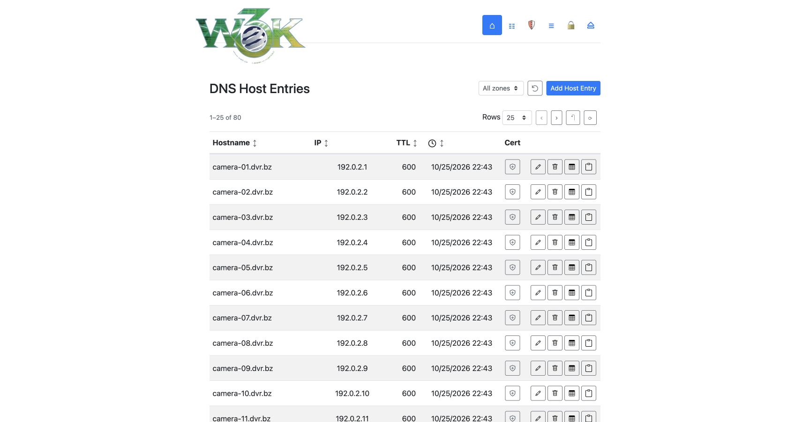

## What it does

| Area | Capabilities |
|---|---|
| Hosts | Per-host update credentials; independent A and AAAA updates; zone filtering; sorting and reset; dedicated certificate actions |
| DNS records | A, AAAA, CNAME, TXT, MX, SRV, CAA and delegated NS; existing aliases appear automatically; all-zone/per-zone views and sorting |
| Certificates | Automatic wildcard + apex certificates per zone; dedicated host certificates; renewal, revocation, ZIP and individual PEM downloads |
| Sign-in | Admin password, optional Google sign-in with an exact email allowlist, and passkeys |
| Monitoring | Update history, failed authentication details, hostname tooltips and temporary blocking of repeated failed admin logins |
| Deployment | Docker images for `linux/amd64`, `linux/386`, `linux/arm/v7` and `linux/arm64`; persistent SQLite and BIND volumes |

Navigation uses icons with labels available on hover and to assistive technology.
The original oversized logo is preserved, with consistent initial page spacing.

## Quick start

### 1. Prepare DNS and HTTPS routing

Use a zone you control, such as `ddns.example.com`, and an authoritative nameserver
such as `ns.example.com`. In the parent zone, configure delegation and the
nameserver's reachable address:

```dns
ddns.example.com.  IN NS    ns.example.com.
ns.example.com.    IN A     203.0.113.10
; Add AAAA only when the authoritative endpoint is reachable over IPv6.
```

Public resolvers must be able to reach your authoritative DNS endpoint over both
UDP and TCP port 53. DNS delegation is separate from the web interface's HTTPS
reverse proxy. HTTP proxying alone does not provide authoritative DNS service.
If the nameserver is inside a delegated zone, arrange the necessary glue records.

Serve the web interface through your existing HTTPS reverse proxy. The app listens
on port 8080 inside the container. The example below binds that HTTP port only to
loopback for a proxy running on the same host; adapt the private connection when
using a proxy container or another host.

### 2. Create persistent credentials

Generate an htpasswd entry and a random session secret:

```sh
# Prompts for the administrator password; requires Apache's htpasswd utility.
export DDNS_ADMIN_LOGIN="$(htpasswd -nB admin)"
export DDNS_SESSION_SECRET="$(openssl rand -base64 32)"
```

Store both values in your deployment's private environment or secret store and
reuse them across restarts. The session secret must contain **at least 32 bytes**.
When putting an htpasswd value directly into Compose YAML, escape each `$` as `$$`;
when using a Compose `.env` file, single-quote the literal value. Do not commit
credentials or `.env` files.

### 3. Deploy

```yaml
services:
  ddns:
    image: w3kllc/ddns:v2.2.2
    restart: unless-stopped
    ports:
      - "127.0.0.1:8080:8080"
      - "53:53/tcp"
      - "53:53/udp"
    environment:
      DDNS_ADMIN_LOGIN: "${DDNS_ADMIN_LOGIN:?Set an htpasswd entry}"
      DDNS_SESSION_SECRET: "${DDNS_SESSION_SECRET:?Set a persistent 32-byte minimum secret}"
      DDNS_DOMAINS: "ddns.example.com"
      DDNS_PARENT_NS: "ns.example.com"
      DDNS_DEFAULT_TTL: "600"
      TZ: "America/New_York"
      DDNS_TRUSTED_PROXIES: "${DDNS_TRUSTED_PROXIES:-}"
    volumes:
      - bind-data:/var/cache/bind
      - database:/root/database
volumes:
  bind-data:
  database:
```

Run `docker compose up -d`, or deploy through your existing stack manager. Open
`https://your-admin-host/@/`, sign in, and add a host. Preserve both volume mounts
when updating an existing deployment; do not accidentally create empty replacement
volumes under different names.

The [development Compose file](deployment/docker-compose.yml) also supports local
builds. Replace its example administrator credential before use.

### Reverse proxy headers

Set `DDNS_TRUSTED_PROXIES` to the exact proxy IPs/CIDRs **as seen by the app**.
The app ignores forwarded client-IP and HTTPS headers from other peers. With
multiple proxy hops, configure the trusted chain and have the edge sanitize
client-supplied forwarding headers.

A typical nginx HTTPS location is:

```nginx
location / {
    proxy_pass http://127.0.0.1:8080;
    proxy_set_header Host $host;
    proxy_set_header X-Real-IP $remote_addr;
    proxy_set_header X-Forwarded-For $proxy_add_x_forwarded_for;
    proxy_set_header X-Forwarded-Proto $scheme;
}
```

Configure TLS on the surrounding virtual host. Google/passkey authentication and
certificate downloads require HTTPS. The DDNS API continues accepting HTTP for
older devices; a proxy-wide HTTP-to-HTTPS redirect can prevent those devices from
updating, so configure redirects according to your clients' capabilities.

## Hosts and DDNS clients

Create each dynamic host in **Hosts** with its hostname, zone, TTL, username and
password. These are **device credentials**, separate from the administrator's
login. Usernames may be shared between hosts; authentication also checks the
requested hostname. Passwords remain case-sensitive.

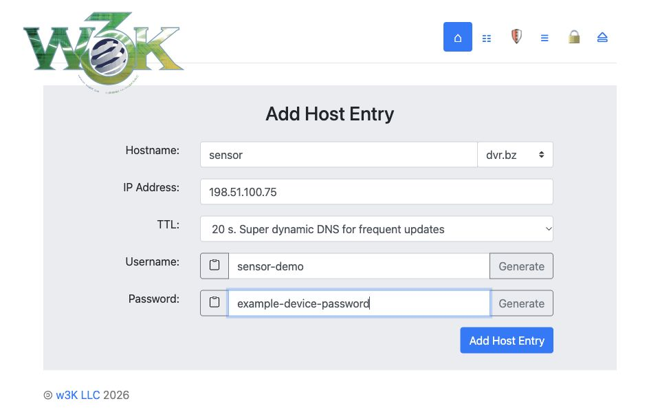

The update API accepts the same parameters on all four routes:

```text
GET /update
GET /nic/update
GET /v2/update
GET /v3/update
```

| Parameter | Meaning |
|---|---|
| `hostname` | Required fully qualified hostname already configured in Hosts |
| `myip` | IPv4 or IPv6 address; omit to use the caller address |

Use HTTP Basic authentication with that host's credentials. These examples prompt
for the device password rather than including it in the command:

```sh
# IPv4: updates A only.
curl --user device-user \
  'https://your-admin-host/nic/update?hostname=router.ddns.example.com&myip=192.0.2.10'

# IPv6: updates AAAA only.
curl --user device-user \
  'https://your-admin-host/nic/update?hostname=router.ddns.example.com&myip=2001:db8::10'
```

For dual-stack operation, send one request per address family. Updating A does not
erase AAAA, and vice versa. The Hosts IP column displays the most recently updated
address, not a complete inventory of both DNS RRsets. Send `myip` explicitly when
a proxy cannot reliably convey the client's address family.

The current implementation returns `good` for a successful update. Failure bodies
include `badauth`, `notfqdn`, `badrequest` and `dnserr`; inspect the HTTP status and
update logs as well. Clients should not depend on an echoed IP or a `nochg`
response. Legacy HTTP Basic authentication remains separate from admin sessions.

### Timezone and table controls

Set `TZ` to an IANA zone, such as `America/New_York`; UTC is used when unset.
Host timestamps are converted to that zone with daylight saving time support.
Hover over the **sortable clock icon** to see the zone. Dates stay on one line,
and `Never` identifies a host that has not updated yet. Timezone data is embedded
in the application.

Use the zone selector to restrict the list. Click Hostname, IP, TTL or the clock
to sort; click again to reverse direction. The reset icon restores the original
entry order without clearing the zone filter.

## DNS editor, including existing CNAMEs

**DNS records** manages static records and all CNAME aliases in one place.
Existing CNAMEs appear with their current hostname, target and TTL—no recreation
is necessary. Old `/@/cnames` bookmarks redirect to this editor. Use **All zones**
or a specific zone, sort by hostname, target/value or TTL, and reset the ordering.

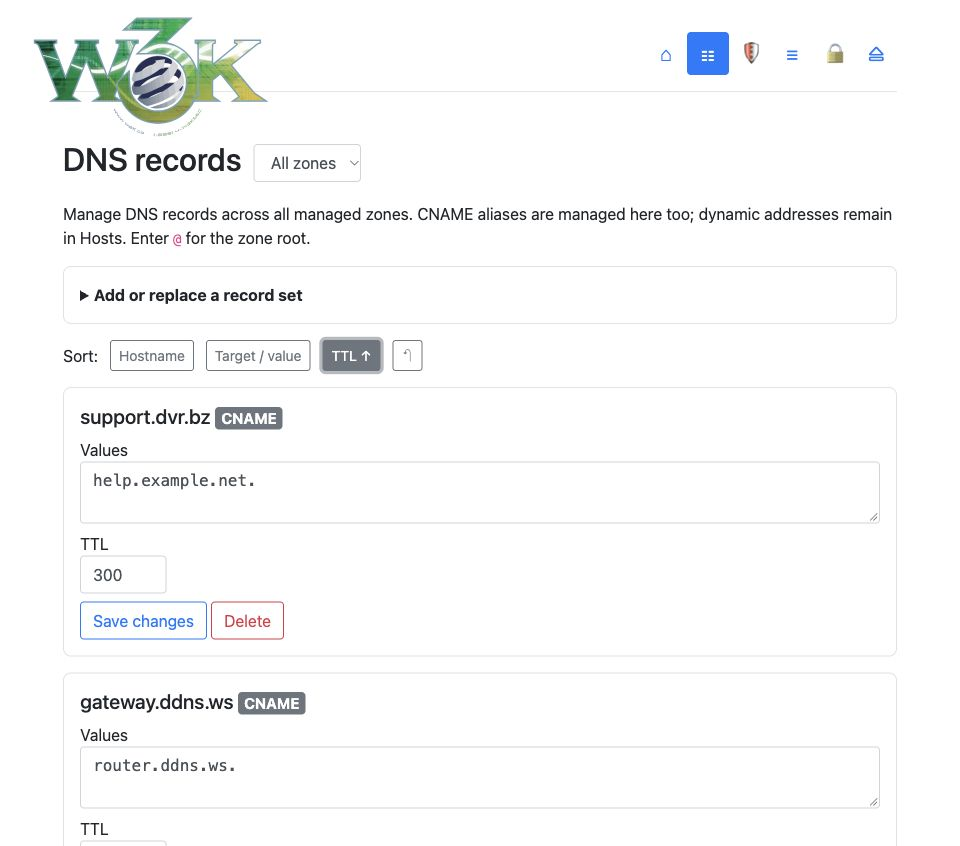

A CNAME points to another **hostname**, not an IP. When a DDNS client changes that
target's A/AAAA records, the alias resolves to the new address automatically.
**CNAMEs are not updated through the DDNS API.**

Expand **Add or replace a record set**, select a zone and type, and enter one value
per line. Use `@` for the zone root. Saving replaces the complete set of values
for that name/type; other compatible record types remain intact.

| Type | Example value | Notes |
|---|---|---|
| A | `192.0.2.25` | Static IPv4 address |
| AAAA | `2001:db8::25` | Static IPv6 address |
| CNAME | `router.ddns.example.com` | Full target hostname; cannot coexist with other data at the same name |
| TXT | `v=spf1 -all` | Plain text without surrounding quotes; long values are split automatically |
| MX | `10 mail.example.net` | Preference followed by full mail-server hostname |
| SRV | `10 5 5060 sip.example.net` | Priority, weight, port, target; use an owner such as `_sip._tcp` |
| CAA | `0 issue letsencrypt.org` | Flags, property tag, value |
| NS | `ns.child.example.net` | Subzone delegation; apex NS/SOA remain managed by BIND setup |

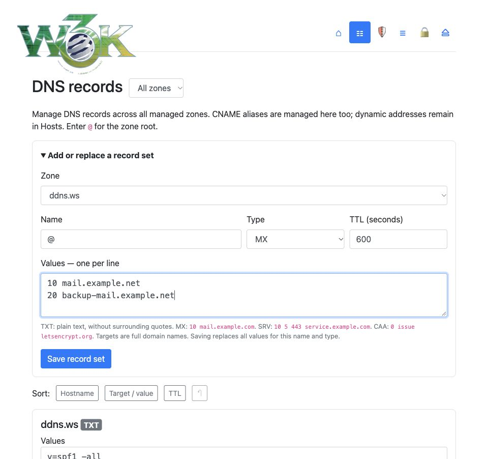

Dynamic host A/AAAA records remain managed in **Hosts** and cannot be overwritten
from the static editor. CNAME conflicts and invalid DNS values are rejected.
MX targets cannot be CNAMEs. In-zone MX/NS targets need the appropriate address or
glue records. ACME challenge names are reserved for certificate validation.

Existing aliases are displayed directly from their stored data. When explicitly
saved or deleted through the editor, the database and DNS update are handled
together; a failed DNS write preserves the previous stored alias.

## Certificates

### Automatic zone certificates

Open **Certificates → Automatic certificates**. Enter a contact email, choose
RSA 2048 or EC P-256, enable automatic issuance, and accept the CA subscriber
agreement. Automation is disabled until configured.

The app maintains **one apex + wildcard certificate per managed zone**, for example
`ddns.example.com` and `*.ddns.example.com`. A scheduler checks every minute, issues
missing certificates serially, and renews opted-in certificates within 30 days of
expiry, or after two-thirds of their lifetime for short-lived certificates.
Failures retry with backoff from one hour to 24 hours. Removing a managed zone
stops its automatic renewals. Disabling automatic issuance does not turn off
renewal for existing certificates that already have it enabled.

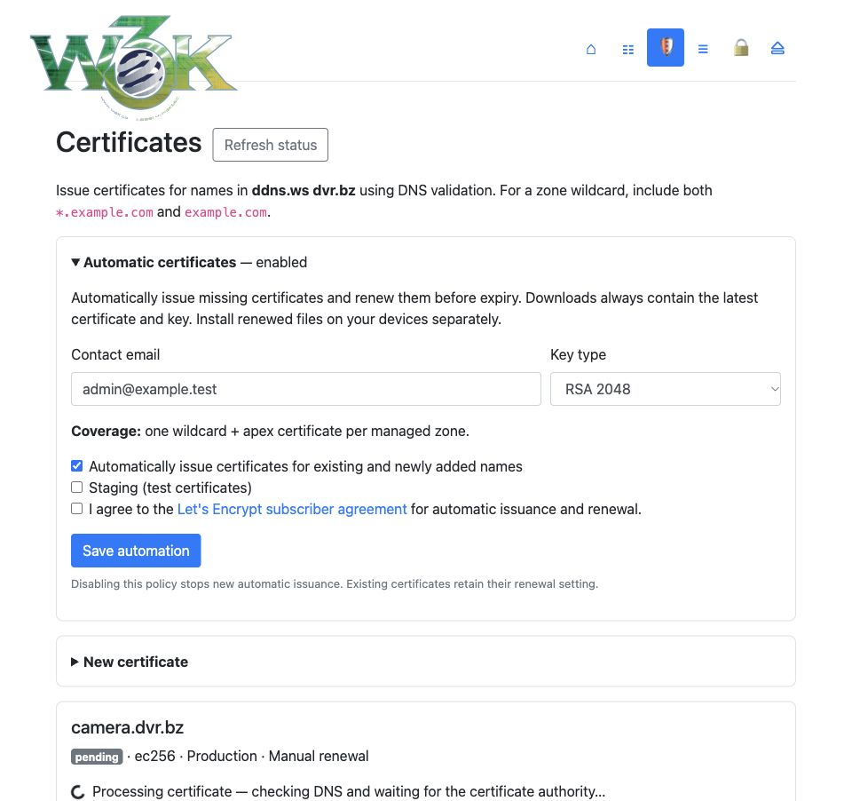

### Dedicated certificates for devices

Use the certificate icon on a host row, or **New certificate** with a single
hostname. Automatic renewal is selected by default. Keep zone wildcard keys for
operator-controlled infrastructure; distribute a dedicated certificate for each
client host.

A host's download icon selects only its dedicated, non-staging, single-name
certificate. **It never falls back to a wildcard or multi-name certificate.**
Wildcard packages remain available on the authenticated Certificates page.

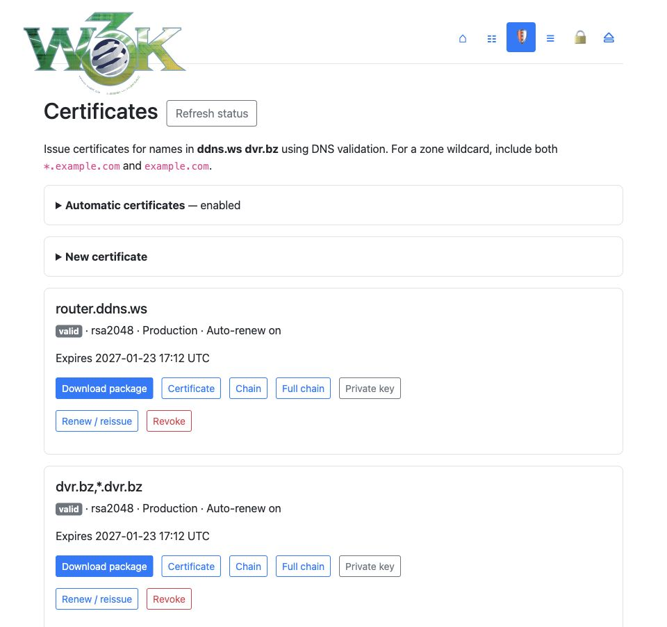

A ZIP package contains:

- `cert.pem` — leaf certificate.
- `chain.pem` — issuer chain.
- `fullchain.pem` — leaf plus chain.
- `privkey.pem` — private key.

Individual PEM downloads, manual renewal/reissue, revocation and activity history
are also available. Downloads require an authenticated HTTPS admin session, use
`no-store`, and are audited. A failed renewal retains the previous certificate/key
until a replacement succeeds. Reissue creates a fresh private key.

**Renewal on the server does not install certificates on your devices.** Download
and deploy the renewed files separately; there is no public client certificate
API or automatic device installation in this release.

### Processing and DNS validation

An animated indicator appears during issuance/renewal. The page polls an
authenticated status endpoint and reloads when the operation succeeds or fails.
Temporary connection errors retry with backoff instead of repeatedly reloading
the page or discarding form input.

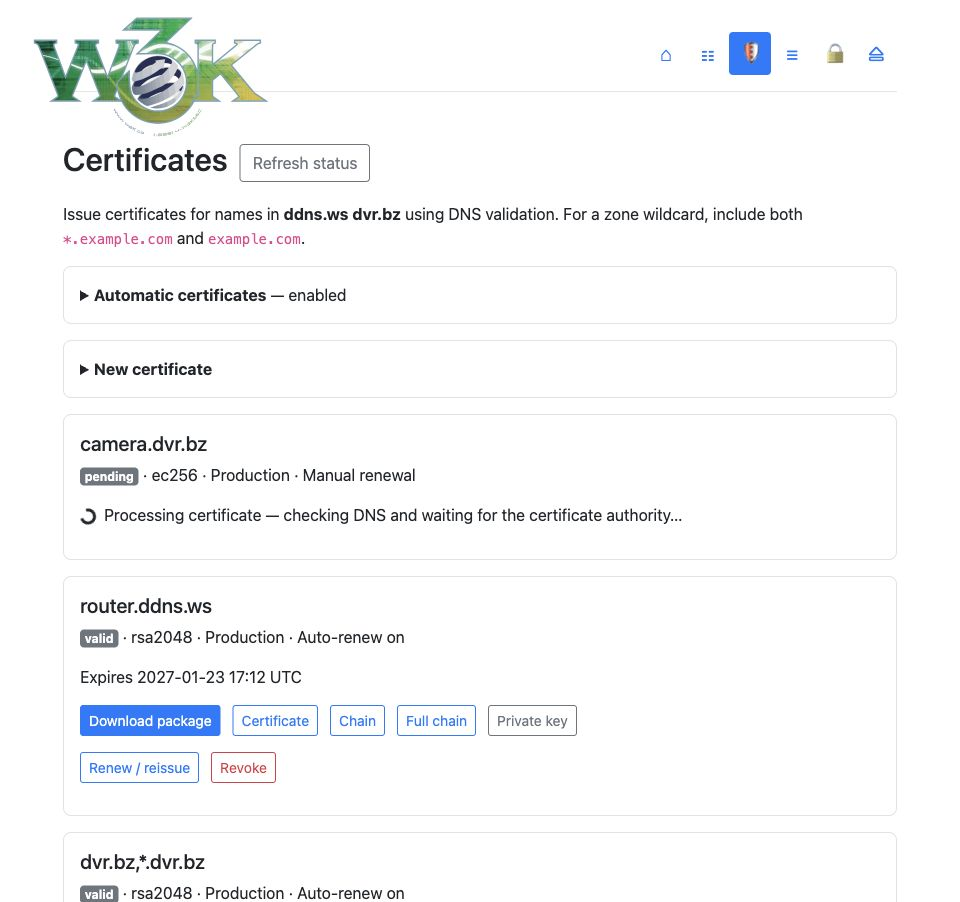

DNS-01 validation adds exact TXT challenge values and preserves unrelated TXT
records and concurrent apex/wildcard challenges. Interrupted challenges are
journaled for cleanup. The local readiness check queries BIND at `127.0.0.1:53`
by default, avoiding public-IP hairpin/NAT reflection problems. This does not
replace the CA's public validation: delegation must reach the authoritative
server and any CAA policy must permit Let's Encrypt.

### Certificate storage

Certificate and ACME account private keys are encrypted with AES-256-GCM. A random
32-byte encryption key is stored as `/root/database/cert.key` with mode 0600 unless
`DDNS_CERT_KEY` is configured. **Back up the whole database volume, including that
key file, or retain the configured encryption key.** Losing the key makes stored
private keys unrecoverable. It is separate from the session signing secret.

## Google sign-in and passkeys

Password login remains available for recovery. Optional Google and passkey login
provide admin access; they do not change device credentials or enable public
registration.

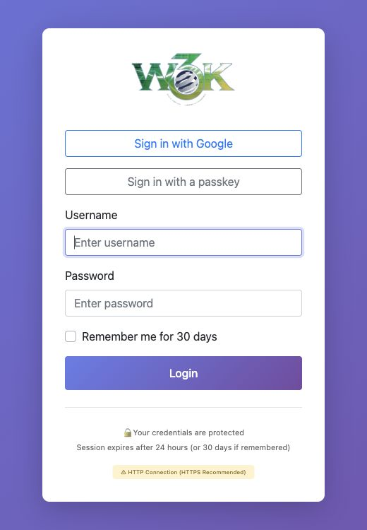

### Configure Google for your own deployment

1. Choose one canonical HTTPS admin origin, such as `https://ddns.example.com`.
2. In your own Google Cloud project, configure the app's branding and audience,
   then create an OAuth client of type **Web application**. If testing, add the
   intended administrators as Google test users too.
3. Register this exact **authorized redirect URI**, substituting your origin:

   ```text
   https://ddns.example.com/@/auth/google/callback
   ```

4. Configure your own client credentials and exact administrator email allowlist:

   ```yaml
   environment:
     DDNS_AUTH_ORIGIN: "https://ddns.example.com"
     DDNS_GOOGLE_CLIENT_ID: "${DDNS_GOOGLE_CLIENT_ID:?Set your Google web client ID}"
     DDNS_GOOGLE_CLIENT_SECRET: "${DDNS_GOOGLE_CLIENT_SECRET:?Set your client secret}"
     DDNS_GOOGLE_ALLOWED_EMAILS: "owner@example.com"
   ```

5. Preserve `DDNS_ADMIN_LOGIN`, `DDNS_SESSION_SECRET` and both data volumes,
   redeploy, then test **Sign in with Google** at the canonical origin.

No w3K Google account or OAuth credential is embedded in the image. Every operator
supplies their own credentials and allowlist. Email matching is case-insensitive;
comma-separated additional emails grant full administrator access. Wildcard and
domain-wide signup are not supported. Only `openid` and `email` scopes are used,
and Google must report the email as verified.

The first successful login pins the Google account's stable subject. A different
account taking over the same email is rejected. Removing an allowed email revokes
its existing Google sessions and passkeys enrolled through that identity. Planned
account replacement requires a database backup and deliberate removal of that
email's entry from `google_identities` before enrolling the replacement.

### Enroll and manage passkeys

Set `DDNS_AUTH_ORIGIN` to enable passkeys; Google is optional. Sign in with the
admin password or Google, then open **Security → Manage passkeys** within five
minutes. Give the credential a name, choose **Add passkey**, and complete the
authenticator's fingerprint, face, PIN or security-key prompt.

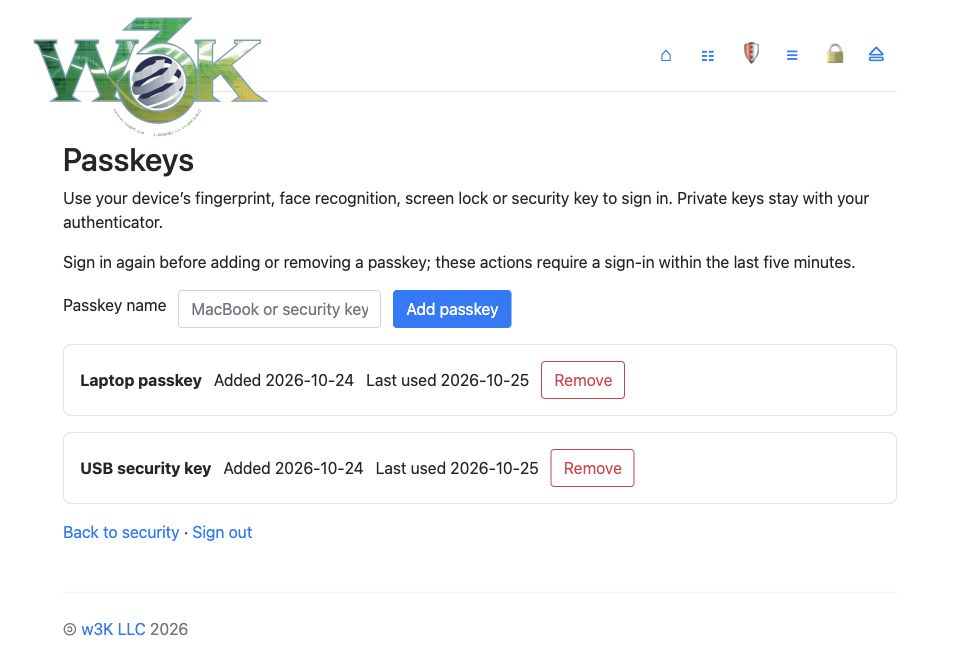

Use **Sign in with a passkey** on later visits. Passkeys are bound to the canonical
hostname and require user verification. Removing a passkey requires a fresh login
and invalidates sessions created with that credential. Remove its saved entry
from the authenticator separately if desired. Private passkey material stays on
the authenticator; the app stores public credential and identity metadata.

Google/WebAuthn login challenges are browser-bound, single-use and short-lived.
Restarting the app interrupts unfinished sign-ins. Invalid or partial Google
configuration fails startup. Keep a recovery sign-in method available.

## Logs and security

**Update logs** show the hostname, submitted IP, caller IP, user agent and outcome
of device updates. The per-host log action narrows the history to one host.

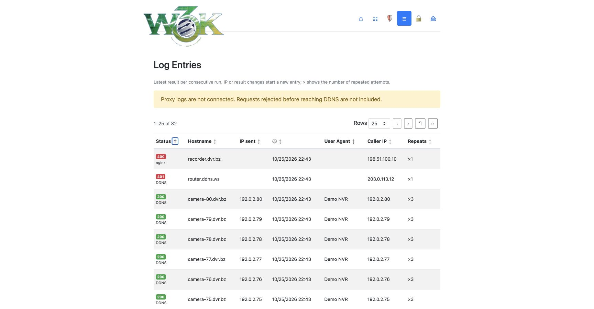

**Security** shows recent failed authentications and active IP blocks. Hover over
an IP to see the hostname requested by a failed DDNS update. Keyboard focus also
reveals that tooltip. Older entries without captured or recovered hostname data
show `Hostname not recorded`.

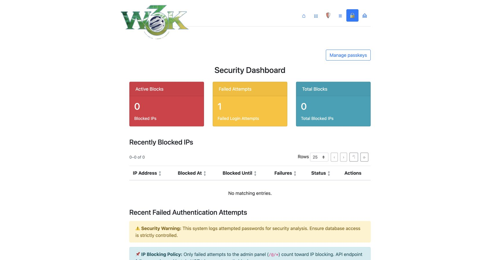

Only failed **admin-panel** logins count toward automatic blocking: three failures
within 72 hours trigger a seven-day block. Failed DDNS API authentication is logged
but does not trigger those blocks. Expired blocks and old failed-auth records are
cleaned up; failed-auth retention is 30 days. `DDNS_CLEAR_LOG_INTERVAL` controls
the separate update-log cleanup interval.

Attempted passwords are intentionally retained for security analysis and hidden
in the interface until revealed. The log database and its backups therefore
contain sensitive data. Container access logs omit URL query strings; nginx or
other upstream access logs may retain them independently.

<details>
<summary>Full failed-attempt and blocked-IP views</summary>

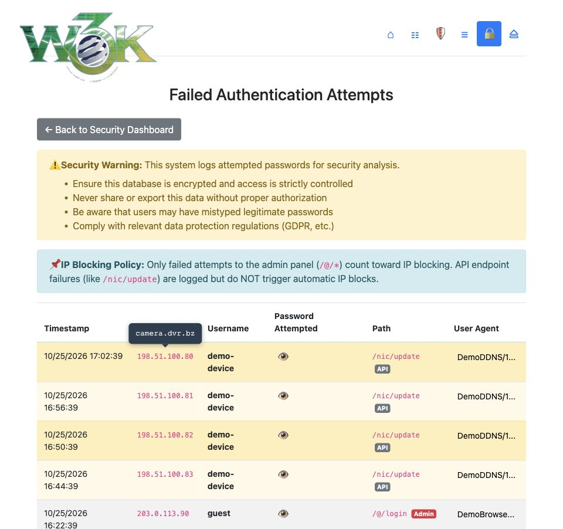
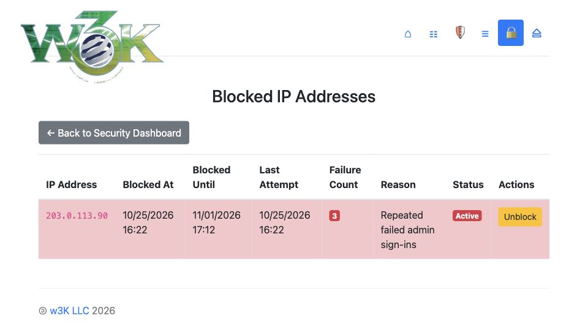

</details>

## Configuration reference

| Variable | Purpose / default |
|---|---|
| `DDNS_DOMAINS` | Required comma-separated managed zones |
| `DDNS_PARENT_NS` | Required authoritative nameserver hostname used by BIND setup |
| `DDNS_DEFAULT_TTL` | Required initial zone TTL in seconds |
| `DDNS_ADMIN_LOGIN` | htpasswd entry for the admin login; required for normal authenticated operation |
| `DDNS_SESSION_SECRET` | Required persistent signing secret, at least 32 bytes |
| `DDNS_TRUSTED_PROXIES` | Trusted proxy IPs/CIDRs; forwarded headers are otherwise ignored |
| `TZ` | Display timezone; e.g. `America/New_York`, UTC when unset |
| `DDNS_TITLE` | Browser title / fallback branding; defaults to `w3K DynDNS` |
| `DDNS_ALLOW_WILDCARD` | Enable wildcard behavior for dynamic hosts; default false |
| `DDNS_NGINX_LOG_DIR` | Optional read-only directory of dedicated nginx `access.log*` files for proxy failure ingestion |
| `DDNS_CLEAR_LOG_INTERVAL` | Days of update-log retention; omitted/zero disables that periodic cleanup |
| `DDNS_LOGOUT_URL` | Optional post-logout destination |
| `DDNS_POWERED_BY` | Footer name; defaults to `w3K LLC` |
| `DDNS_POWERED_BY_URL` | Footer link; defaults to `https://w3K.one/` |
| `DDNS_AUTH_ORIGIN` | Canonical HTTPS origin for Google/passkeys, without a path |
| `DDNS_GOOGLE_CLIENT_ID` | Your Google OAuth web client ID |
| `DDNS_GOOGLE_CLIENT_SECRET` | Your Google OAuth client secret |
| `DDNS_GOOGLE_ALLOWED_EMAILS` | Required exact email allowlist when Google is configured |
| `DDNS_ACME_EMAIL` | Prefills certificate contact email |
| `DDNS_CERT_KEY` | Optional stable 64-character hex encryption key instead of `cert.key` |
| `DDNS_ACME_AUTHORITATIVE_NS` | Direct TXT readiness-check endpoint; defaults to `127.0.0.1:53` |
| `DDNS_ACME_RESOLVERS` | Optional comma-separated recursive resolver endpoints |
| `DDNS_ACME_DIRECTORY` | Fixed ACME directory override for isolated tests; overrides staging selection |
| `DDNS_ALLOW_INSECURE_DOWNLOAD` | Isolated HTTP tests only; default false |

Omitting `DDNS_ADMIN_LOGIN` retains a legacy unauthenticated mode for some old
admin routes. The DNS/certificate features and additional sign-in methods require
configured admin authentication. Use the authenticated setup above.

### Custom logo

The app checks `static/icons/logo.png`, then `.webp`, then `.svg` relative to its
working directory. In the image, that directory is **`/root/static/icons`**.
For example, replace the bundled PNG without hiding the rest of the static assets:

```yaml
volumes:
  - ./logo.png:/root/static/icons/logo.png:ro
```

Without a detected logo, the interface shows `DDNS_TITLE`.

## Live lists and complete update activity

Hosts, DNS records, certificates, update activity and security lists share pagination
(25, 50, 100 or 250 entries), sorting, reset controls and live text filters. Click a
column heading to reveal its filter; use the separate arrow to sort. Matching is
case-insensitive and updates as you type. Filters apply before pagination.
Background refreshes run every ten seconds and preserve filters, sorting and page
selection. They pause while a form is being edited or the tab is hidden. Failed
refreshes keep the existing rows visible and show a retry message.

Pages use normal document scrolling at every window size. Only the top menu and
logo remain sticky; page introductions, list controls and column headings scroll
with the content. Security's passkey link stays at the right,
and its three summary cards use compact, single-line labels.

**Log Entries** combines successful/failed DNS updates, rejected API credentials,
missing/malformed Basic Auth, and optional reverse-proxy failures. The status badge
shows the HTTP code and source; hover it for the result description. Consecutive
identical results for each hostname collapse into their latest entry, with a repeat
count and first-attempt time. IP, status, result, client or source changes create a
new entry; A → B → A remains three separate runs. Security failures also collapse
only identical consecutive attempts, preserving changes in attempted credentials.
Original retained events remain available in the database.

### Include nginx failures

A request rejected by nginx never reaches the application. To include those errors,
mount the **dedicated DDNS nginx log directory** read-only and configure:

```yaml
environment:
  DDNS_NGINX_LOG_DIR: /var/log/ddns-nginx
volumes:
  - /path/to/ddns/nginx/logs:/var/log/ddns-nginx:ro
```

The importer accepts standard nginx combined-format `access.log*` files, including
plain and gzip rotations. Every ten seconds it reads only appended data from plain
files, persisting its inode/offset and a truncation-detection anchor in SQLite.
Each immutable gzip rotation is processed once. Inserts are idempotent across
restarts and rotation; matched application errors are not shown twice. Initial
plain-file backfill is limited to 4 MiB per file per pass. Only update-route errors
(HTTP 400–599) are imported, and only timestamp, hostname, IPs, route, status and
user agent are stored—not raw URLs, authorization headers or passwords. The importer
uses the configured log retention; zero disables expiry. Do not mount a directory
containing unrelated sites' logs. The Log Entries page reports a missing/unreadable
mount instead of claiming proxy failures are included.

Standard access logs record the HTTP status, not the response body. A proxy `400`
is therefore labelled **Bad Request**, not an invented explanation. For example,
plain HTTP sent to HTTPS port 443 is a proxy-level failure: configure the device for
HTTP/80 or actual HTTPS/443. HTTP/80 and HTTPS/443 are both supported.

## Backups, upgrades and recovery

Preserve the BIND volume (`/var/cache/bind`), database volume (`/root/database`),
deployment configuration, session secret and any configured certificate encryption
key. The database includes hosts, aliases, records, logs, certificate/account
material, passkey public credentials and Google identity pins.

Take a consistent database backup: either use SQLite's backup API or stop the
application through its deployment manager before copying the whole volume.
Copying only a live `ddns.db` can miss writes still in its WAL. Include `cert.key`
in the same backup set, and retain the BIND zone files and journals.

For upgrades, re-pull the desired image and recreate the service through the same
manager that owns the stack. Keep volume names and mounts unchanged. If a tag has
been republished, a restart alone does not pull the replacement image.

Older installations need a persistent `DDNS_SESSION_SECRET`. The admin interface
is `/@/`, with `/@/login` for sign-in. Device update URLs and per-host Basic Auth
remain compatible. Schema additions and legacy normalization run automatically;
existing CNAMEs appear in the unified editor.

## Troubleshooting

| Symptom | Check |
|---|---|
| Startup says session secret must contain at least 32 bytes | Supply a persistent random `DDNS_SESSION_SECRET` and recreate the service |
| Login loops or HTTPS downloads fail behind a proxy | Verify the proxy's actual source address is trusted and its HTTPS headers are correct |
| Google rejects the callback | Match the canonical origin and exact `/@/auth/google/callback` URI; check the client credentials, audience/test users and local email allowlist |
| Passkey enrollment/removal is rejected | Use the canonical HTTPS host and sign in again within the last five minutes |
| Device returns `badauth` | Use the host's credentials, not the admin login; verify the exact hostname |
| Detected IP is a proxy address | Fix the trusted forwarding chain or send `myip` explicitly |
| Certificate issuance fails | Check the displayed error, public delegation, UDP/TCP 53 reachability, CAA, local BIND readiness and container logs |
| Certificates unavailable after restore | Restore the matching `cert.key` or configured `DDNS_CERT_KEY`; do not generate a replacement for encrypted existing data |
| Data missing after upgrade | Verify the original database/BIND volumes are mounted |
| Database locked | Verify a single app instance owns the SQLite database |
| Old page styling after a same-version update | Confirm the replacement image was pulled and refresh the browser cache |

## Development and verification

```sh
cd dyndns
go build ./...
go test -race ./...
go vet ./...
cd ..
node --test tests/certificates_poll_test.js
docker build -f deployment/Dockerfile -t ddns-test:local .
python3 tests/m0_smoke.py ddns-test:local
python3 tests/features_smoke.py ddns-test:local
```

The feature smoke test uses disposable BIND and Pebble containers to verify real
DNS-01 challenges, certificate issuance, renewal/key rotation, revocation and
downloads. Use Pebble or the CA staging environment for tests, never Let's Encrypt
production. The Go toolchain version is declared in [go.mod](dyndns/go.mod) and
the [Dockerfile](deployment/Dockerfile).

The [image workflow](.github/workflows/BuildEmAll.yml) builds all four supported
platforms and publishes `latest` and the release tag. It is the only image publisher;
separate Go build/test checks run on branch pushes, without duplicate tag runs.
A commit title beginning with
`vX.Y.Z` selects that version. `v2.2.2` consolidates the certificate readiness/polling,
failed-hostname tooltips, compact timezone heading, aligned layout and unified
CNAME editor changes into one release commit.

### Documentation screenshots

All screenshots use disposable demonstration data: fictional hosts and accounts,
IPv4 documentation ranges and `2001:db8::/32` IPv6 addresses. The zone names
`ddns.ws` and `dvr.bz` are retained for illustration. Certificate and passkey states
are seeded examples; screenshots do not show customer data or live credentials.

To reproduce the preview, build the current image and run:

```sh
# Requires Docker and Python's cryptography package.
python3 tests/docs_preview.py --image ddns-test:local
```

The preview binds to loopback, prints its URL and fixture login, and deletes its
temporary container and database when stopped. Its local proxy supplies test
forwarding headers to exercise the canonical-origin screens. No real Google
login, authenticator enrollment or production CA issuance is performed.

## License and project history

[MIT License](LICENSE). Maintained by **w3K LLC**, building on
[David Prandzioch's Docker DDNS server](https://github.com/dprandzioch/docker-ddns)
and [Benjamin Bärthlein's web UI fork](https://github.com/benjaminbear/docker-ddns-server).

### w3K branding and 404 page

The branded distribution includes the shared w3K 404 v1.5.9 game on browser page misses, with a landing overlay extending 10 px around the canvas and colors that blend with the page. API errors, missing static assets, HEAD requests and non-HTML clients retain their normal responses. Score posting is disabled for this instance. Hold **Shift + Alt** (Option on macOS) to reveal the w3K badge. These additions are specific to this fork and are excluded from the neutral upstream contribution.

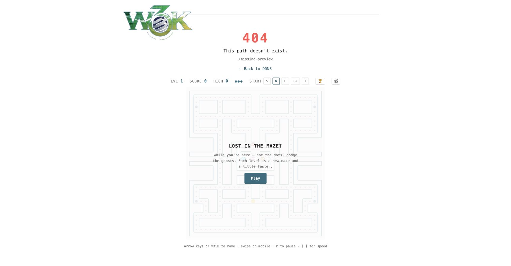
